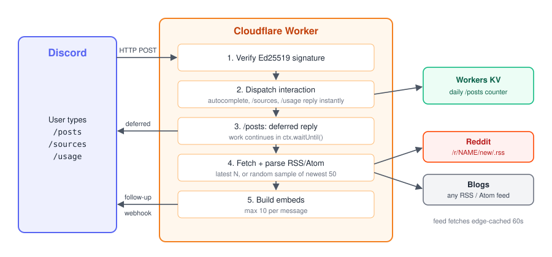

# discord-feed-bot

A Discord bot with three slash commands — `/posts` (recent posts from a
subreddit or a configured RSS/Atom feed), `/sources` (lists configured
sources, grouped as Reddit vs Websites), and `/usage` (how many `/posts`
calls are left today against a self-imposed daily budget). It runs
entirely as a Cloudflare Worker — there is no gateway/websocket
connection and no always-on process. The Worker only executes when Discord
sends it an interaction HTTP request, so it stays comfortably within
Cloudflare Workers' free tier.

Every source — subreddit or RSS/Atom — is fetched as a plain RSS/Atom
feed. Subreddits and sources flagged `"category": "daily"` in
`feeds.json` always return the latest items; every other source (blogs
like Big Think, Psyche, Medium, etc.) returns a random sample from its
recent posts instead, so slow-moving feeds don't just show the same
handful of articles on every call — see **Categories: daily vs general**
below. There's no dedup or per-call state: two people (or the same person
twice) calling `/posts` for the same source never affect each other, and
may see the same post again. Subreddits are fetched from Reddit's own `.rss` feeds
(`https://www.reddit.com/r/SUBREDDIT/new/.rss`); Reddit's JSON listing API
and OAuth were both tried in earlier versions of this bot and dropped —
see **Reddit access history** below for why. Because it's plain RSS,
subreddit results carry no score/comment-count data or filtering, same as
any blog/RSS-Bridge source.



## Quick start

Run your own copy on your Discord server. You need Node.js 18+, a free
Cloudflare account, and a Discord account. The numbered sections below
explain each step in more detail.

1. Create an application at https://discord.com/developers/applications.
   Copy its **Application ID** and **Public Key** (General Information) and
   its **bot token** (Bot tab → Reset Token).
2. Invite it to your server: **OAuth2 → URL Generator**, tick the `bot` and
   `applications.commands` scopes, and open the generated URL.
3. Clone and install:
   ```bash
   git clone https://github.com/giorgimskh/discord-feed-bot.git
   cd discord-feed-bot
   npm install
   cp feeds.example.json feeds.json
   ```
4. Log in to Cloudflare and create the KV namespace:
   ```bash
   npx wrangler login
   npx wrangler kv:namespace create FEED_STATE
   ```
   Paste the printed `id` into the `[[kv_namespaces]]` block in `wrangler.toml`.
5. Store the Discord credentials as Worker secrets (paste each value when prompted):
   ```bash
   npx wrangler secret put DISCORD_PUBLIC_KEY
   npx wrangler secret put DISCORD_BOT_TOKEN
   npx wrangler secret put DISCORD_APP_ID
   ```
6. Deploy:
   ```bash
   npm run deploy
   ```
7. Copy the printed `https://….workers.dev` URL into **Interactions Endpoint
   URL** on the app's General Information page and click **Save**.
8. Register the slash commands. Right-click your server → **Copy Server ID**
   (requires Developer Mode in Discord's Advanced settings):
   ```bash
   DISCORD_APP_ID=... DISCORD_BOT_TOKEN=... DISCORD_GUILD_ID=... npm run register
   ```
9. In your server, try `/sources`, `/posts source:programming`, and `/usage`.

To change which sources the bot offers, edit `feeds.json` and run
`npm run deploy` again.

## How it works

- Discord calls the Worker's URL directly (HTTP interactions), not a
  persistent gateway connection.
- Every request's Ed25519 signature is verified with `discord-interactions`'s
  `verifyKey` before anything else runs.
- `source` is looked up in `feeds.json`. A **string** value is an RSS/Atom
  feed URL (blog, RSS-Bridge); an **object with `subreddit`** is a
  subreddit, fetched from Reddit's `.rss` feed for it. Both paths produce
  the same normalized post shape and go through the same RSS-parsing
  code, so the reply-building code doesn't care which one ran.
- Because fetching and parsing can occasionally take longer than Discord's
  3-second response window, the Worker always replies immediately with a
  "deferred" response, does the real fetching in the background
  (`ctx.waitUntil`), and then posts the results as a follow-up message.
- Every `/posts` call increments a daily counter in the `FEED_STATE` KV
  namespace (`src/usage.js`), checked by `/usage` — see **Usage tracking**
  below.

## Prerequisites

- Node.js 18+ (for `wrangler` and the registration script's native `fetch`)
- A Cloudflare account (free tier is enough)
- A Discord account with permission to create applications

## 1. Create the Discord application

*(You need to do this yourself in the Discord Developer Portal —
https://discord.com/developers/applications)*

1. Click **New Application**, give it a name.
2. On the **General Information** page, copy the **Application ID** and
   **Public Key** — you'll set these as Worker secrets shortly.
3. Go to the **Bot** tab, click **Reset Token** (or **Add Bot** if there
   isn't one yet), and copy the bot token. Treat this like a password.
4. Under **OAuth2 → URL Generator**, select the `applications.commands` and
   `bot` scopes (and whatever bot permissions you want, e.g. "Send
   Messages"), then use the generated URL to invite the bot to your test
   server.
5. **Leave "Interactions Endpoint URL" blank for now** — you can only set
   it after the Worker is deployed, because Discord sends a live `PING` to
   that URL to verify it immediately when you save it (see step 6 below).

## 2. Configure feeds.json

Start from the example (`feeds.json` is gitignored, so your own list stays
local):

```bash
cp feeds.example.json feeds.json
```

Edit `feeds.json` to map short names (what you type as `source` in
`/posts`) to sources. There are three entry shapes:

- **A plain string** — an RSS/Atom feed URL, with no category. Used for a
  blog's native feed, or any feed you don't need `"daily"` semantics for
  (see below — this still gets the random-sample behavior, it's just not
  explicitly tagged `"general"`).
- **An object with `subreddit`** — a subreddit, fetched from Reddit's own
  `.rss` feed (`https://www.reddit.com/r/SUBREDDIT/new/.rss`) rather than
  Reddit's API. Field:
  - `subreddit` (required) — the subreddit name, e.g. `"programming"`.

  Because it's RSS, results carry no score/comment-count data, so there's
  no `listing`/`minScore`/`minComments` filtering — just the newest posts,
  same as any other RSS source.
- **An object with `url` and `category`** — an RSS/Atom feed tagged
  `"daily"` or `"general"` (see **Categories: daily vs general** below).
  - `url` — the feed URL. Can be `null` as a placeholder if you haven't
    found a working feed URL for a source yet — `/posts` returns a clear
    error naming the source instead of crashing until it's filled in.
  - `category` — `"daily"` or `"general"`.

`source` in `/posts` must match one of these configured names (matching
ignores case, surrounding whitespace, and a leading `/`) — there's no
separate "treat it as a subreddit" fallback; a subreddit is just another
entry in this file, with its own shape. Run `/sources` in Discord any time
to see the full current list, grouped under **Reddit** and **Websites**
headings (an entry with `subreddit` is Reddit; everything else is a
Website), with every source's effective category (`daily` or `general`)
shown next to its name.

As you type into `source:`, Discord shows a live dropdown of matching
names — typed via autocomplete, not a hardcoded `choices` list, so it stays
in sync with `feeds.json` automatically. Matching checks the source name
first, then falls back to metadata like the subreddit name or `"reddit"`/
category tags, so e.g. typing `reddit` surfaces every subreddit-backed
source even if "reddit" isn't in its key.

### Categories: daily vs general

`/sources` shows each source's actual selection behavior — `latest` or
`random` — next to its name. This is driven by the source type and the
`"category": "daily"` flag, not something you set directly:

- **`latest`** — subreddits, and any source explicitly flagged
  `"category": "daily"` in `feeds.json`. `/posts` always returns the
  newest `limit` items, every time, for every user.
- **`random`** — every other source (plain-string RSS, or
  `"category": "general"`/unset) — blogs like Big Think, Psyche, Medium,
  etc. `/posts` fetches a wider pool of recent items (up to 50) and
  returns a random sample of `limit` from it, so slow-moving feeds show
  variety across calls instead of the same handful of articles every
  time.

Neither mode tracks per-user or per-call state: nothing is remembered
between `/posts` calls, so one user's call never affects what another
user (or the same user calling again) sees, and the same post can show up
more than once.

### Usage tracking

`/usage` reports how many times `/posts` has been called today against a
daily budget — **this is not a real Cloudflare account limit**, just a
number you set yourself (default `500`, well under Cloudflare's actual
free-tier request quota) to get a sense of how heavily the bot's being
used. Every `/posts` call increments a counter in `FEED_STATE` keyed by
the current UTC date (`src/usage.js`); the counter resets naturally at UTC
midnight and expires on its own via KV's TTL, so there's no cleanup job.
`/posts` itself is **not blocked** once the budget is hit — `/usage` is
informational only.

To change the daily budget, edit `DAILY_POST_LIMIT` under `[vars]` in
`wrangler.toml` and redeploy:

```toml
[vars]
DAILY_POST_LIMIT = "500"
```

If `FEED_STATE` isn't bound, `/usage` still responds but says tracking
isn't active, and always shows the full budget as remaining.

### Medium (per-tag/publication feeds only)

Medium has no single feed for the whole site — only per-tag
(`https://medium.com/feed/tag/TAGNAME`) or per-publication
(`https://medium.com/feed/PUBLICATION-NAME`) feeds. `feeds.example.json`
ships one example entry using the tag `"programming"`:

```json
"medium-programming": { "url": "https://medium.com/feed/tag/programming", "category": "general" }
```

**You need to pick your own tags or publications to follow** and add one
`feeds.json` entry per tag/publication you want — "all of Medium" isn't
fetchable as a single feed. Rename the key and change the tag/publication
in the URL for each one you add.

The shipped example (`feeds.example.json`):

```json
{
  "hn-frontpage": "https://hnrss.org/frontpage",
  "cf-blog": "https://blog.cloudflare.com/rss/",
  "programming": { "subreddit": "programming" },
  "postgresql": { "subreddit": "PostgreSQL" },
  "springboot": { "subreddit": "SpringBoot" },
  "bigthink": { "url": "https://bigthink.com/feeds/feed.rss", "category": "general" },
  "medium-programming": { "url": "https://medium.com/feed/tag/programming", "category": "general" }
}
```

## 3. Install dependencies

```bash
npm install
```

## 4. Set up secrets

**Local development** (`wrangler dev`): copy `.dev.vars.example` to
`.dev.vars` and fill in all three values. `.dev.vars` is gitignored and
never committed.

```bash
cp .dev.vars.example .dev.vars
```

**Production**: set each secret individually — you'll be prompted to paste
the value for each:

```bash
npx wrangler secret put DISCORD_PUBLIC_KEY
npx wrangler secret put DISCORD_BOT_TOKEN
npx wrangler secret put DISCORD_APP_ID
```

## 5. Provision the KV namespace

A Cloudflare Workers KV namespace, bound as `FEED_STATE`, backs the
`/usage` daily-call-count tracking (see **Usage tracking** below) — it's
unrelated to feed fetching or `/posts` itself, which has no dedup/state
of its own. Create the namespace once:

```bash
npx wrangler kv:namespace create FEED_STATE
```

This prints something like:

```
[[kv_namespaces]]
binding = "FEED_STATE"
id = "abcd1234..."
```

Copy that `id` value into `wrangler.toml`, replacing the existing `id` in the
`[[kv_namespaces]]` block that's already there:

```toml
[[kv_namespaces]]
binding = "FEED_STATE"
id = "abcd1234..."
```

`wrangler dev` simulates this namespace locally with no extra setup, so
local development works before you provision the real one too — just
don't expect `/usage` counts to carry over between `dev` and production,
since they're separate namespaces.

## 6. Deploy

```bash
npm run deploy
```

This prints a `*.workers.dev` URL. Copy it, go back to the Discord
Developer Portal → your application → **General Information**, and paste
it into **Interactions Endpoint URL**, then **Save**. Discord immediately
sends a `PING` to that URL to verify it — if this fails, it's almost always
because `DISCORD_PUBLIC_KEY` doesn't match the key shown on that same page.

## 7. Register the /posts, /sources, and /usage commands

For instant availability while testing, register it to a single guild
first (find your server's ID via Discord's "Copy Server ID" in the
Advanced/Developer Mode settings):

```bash
DISCORD_APP_ID=... DISCORD_BOT_TOKEN=... DISCORD_GUILD_ID=... npm run register
```

Once confirmed working, register it globally (no `DISCORD_GUILD_ID`) so it
works in every server the bot is in — this can take up to an hour to show
up everywhere:

```bash
DISCORD_APP_ID=... DISCORD_BOT_TOKEN=... npm run register
```

## 8. Try it

In a server the bot's been invited to:

```
/posts source:programming
/posts source:postgresql limit:3
/posts source:hn-frontpage
/posts source:bigthink
/sources
/usage
```

Every result — subreddit or RSS/Atom — shows a **Published** date field,
since all sources are fetched as plain RSS/Atom and none of it carries
score/comment-count data. `/sources` groups sources under **Reddit** and
**Websites**, with each source's selection behavior (`latest` / `random`)
next to its name. `/usage` shows how many `/posts` calls have been used
today against the daily budget (see **Usage tracking** above).

## Local development

```bash
npm run dev
```

This starts `wrangler dev`, but Discord needs to reach your endpoint over
the public internet to send real interactions — plain `localhost` won't
work for a full round-trip test. Use `wrangler dev --remote`, or a tunnel
tool (e.g. `cloudflared tunnel --url http://localhost:8787`), and point
Discord's Interactions Endpoint URL at the tunnel URL while testing.

## Reddit access history

Subreddit fetching has gone through a few approaches:

1. **Reddit's OAuth `client_credentials` API** — tried first, abandoned
   early because self-registering a new app for it seemed blocked by
   Reddit's Responsible Builder Policy at the time.
2. **Reddit's public, unauthenticated JSON listing endpoints**
   (`https://www.reddit.com/r/SUBREDDIT/LISTING.json`) — used next. This
   stopped working: Reddit now returns `HTTP 403` on these endpoints for
   effectively any non-browser HTTP client — confirmed by testing with a
   verbatim Chrome User-Agent, which was blocked identically to a plain
   one. Not a User-Agent problem, not intermittent, not fixable from this
   codebase's side.
3. **Reddit's OAuth API again** — registering a personal "script" app
   turned out to still be open, and this worked. It was dropped anyway in
   favor of option 4 below, to avoid the ongoing cost of a Reddit app
   registration, stored credentials, and token-caching logic for what
   this bot needs.
4. **Reddit's own `.rss` feeds (current)** — `https://www.reddit.com/r/SUBREDDIT/new/.rss`.
   No credentials, no app registration, same RSS-parsing code path as
   every other source in this bot. The trade-off:
   RSS doesn't expose score or comment count, so subreddit results have
   no ranking data and no `minScore`/`minComments` filtering — every
   subreddit source just shows its newest posts, like any blog.

RSS-Bridge and blog sources were never affected by any of this — they're
plain RSS/Atom fetches with no relationship to Reddit at all.

## Known limitations

- Discord caps messages at 10 embeds; `limit` values above 10 are silently
  clamped.
- Global command registration can take up to an hour to propagate; use
  `DISCORD_GUILD_ID` while iterating.
- Reddit's `.rss` feeds have their own rate limiting. Every feed fetch is
  edge-cached for 60 seconds (keyed by feed URL, via Cloudflare's `cf.cacheTtl`)
  so repeat `/posts` calls for the same subreddit within that window are
  served from cache instead of re-hitting Reddit — but a burst of calls
  spread across many different subreddits, or spaced further apart than
  60 seconds, can still get a temporary `HTTP 429`, which now shows a
  clearer "rate-limiting, try again in a minute" message instead of a raw
  HTTP error.
- Random-sample sources (every non-Reddit, non-`"daily"` source) draw
  from only the newest 50 raw entries per feed, so a source with more
  than 50 items available won't ever surface anything older than that.
- The `medium-programming` entry is only an example — pick your own
  tags/publications to follow (see **Medium** above).
